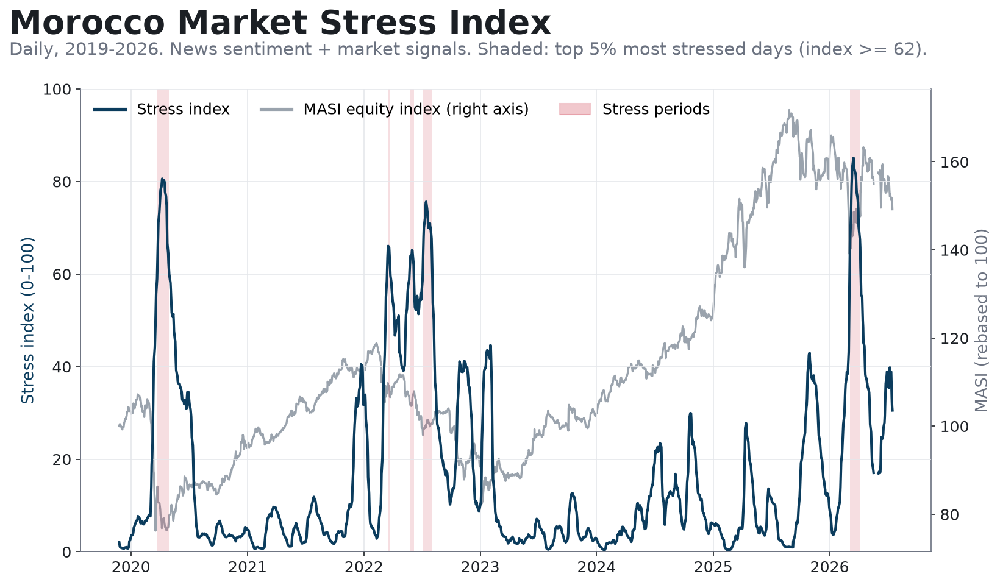
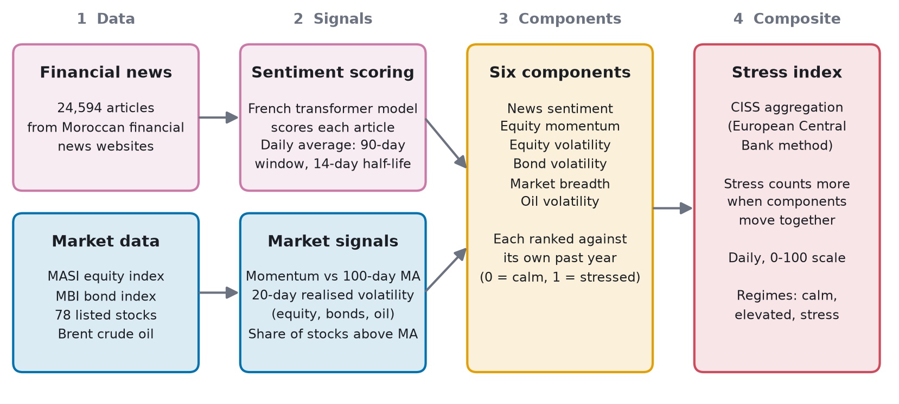
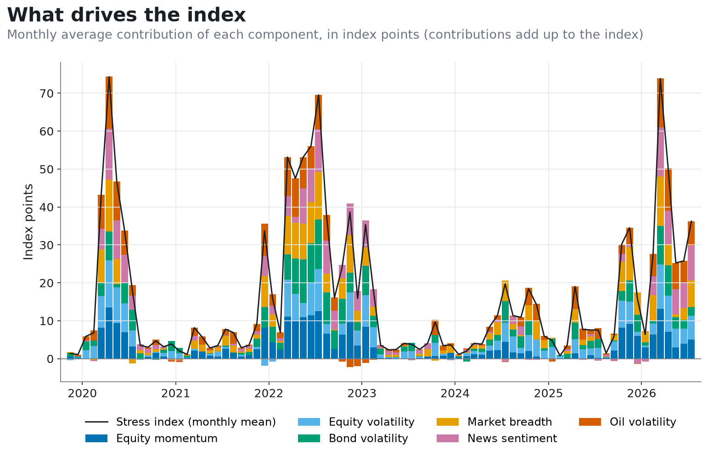
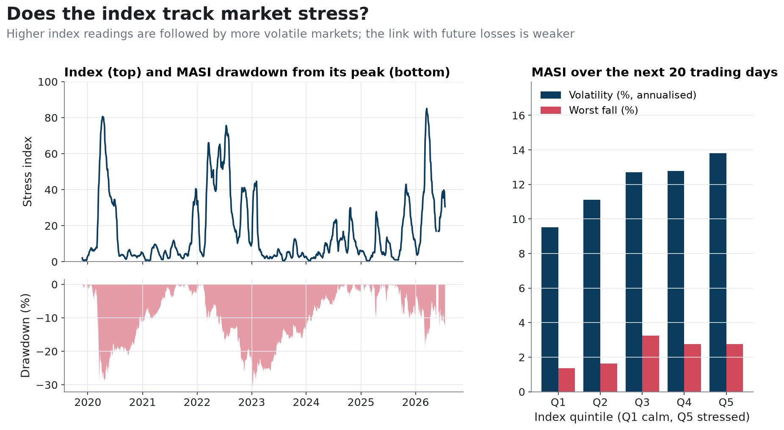

# Morocco Market Stress Index

A daily 0–100 gauge of stress on the Casablanca Stock Exchange. It reads 24,594 articles from Moroccan financial news websites with a French language model and combines their tone with five market signals: equity trend, equity, bond and oil volatility, and the share of stocks in an uptrend. The method is the European Central Bank's CISS, which makes the index jump when stress shows up in several places at once rather than in one corner of the market. The index runs from November 2019 to July 2026, uses only information available by the end of each day, and ships as a CSV plus a one-line Python loader for use in allocation or risk models.



## How it works



1. **Read the news.** Every article is scored by a French sentiment model (`cmarkea/distilcamembert-base-sentiment`) from −1 (reassuring) to +1 (alarming). The daily press tone is the average of the last 90 days of articles, with recent articles counting more: an article's weight halves every 14 days. Both news sources carry the same weight per article.
2. **Measure the market.** Five signals from daily closes: how far the MASI equity index sits below its 100-day average, 20-day volatility of the MASI, of the MBI bond index and of Brent crude, and the share of listed stocks trading above their 52-day average.
3. **Put everything on one scale.** Each of the six signals is compared with its own past year and expressed as a percentile: 0 is the calmest day of the year, 1 the most stressed.
4. **Combine them like a central bank.** The CISS formula (Hollo, Kremer & Lo Duca, ECB Working Paper 1426, 2012) weights the six signals equally and accounts for how closely they move together. One stressed signal moves the index a little; six stressed signals moving together move it a lot.
5. **Read it in real time.** The index is bounded between 0 and 100 by construction, so past values are never revised. A day is labelled *elevated* or *stress* when the index exceeds the 75th or 95th percentile of its own history **up to that day**.

Every step looks only backwards. An automated test recomputes the index on data cut at several dates and checks that past values do not change ([tests/test_no_lookahead.py](tests/test_no_lookahead.py)).

## Key results

All figures below are produced by the code ([reports/key_numbers.json](reports/key_numbers.json)) on data up to 17 July 2026.

**It flags the market's crises.** The MASI fell by more than 10% four times in the sample. In three of them one news topic dominated the headlines, at 6 to 30 times its usual frequency:

| MASI fall | Dominant headline topic | Index peak |
|---|---|---|
| −28.9%, 22 Jan → 18 Mar 2020 | COVID-19 | 80.6 on 8 Apr 2020 |
| −30.5%, 10 Feb 2022 → 6 Jan 2023 | War in Ukraine | 75.6 on 15 Jul 2022 |
| −10.3%, 24 Mar → 9 Apr 2025 | US tariffs | 27.8 on 14 Apr 2025 |
| −19.0%, 27 Aug 2025 → 3 Mar 2026 | none dominant | 85.1 on 17 Mar 2026 |

In calm times the index stays low: its median is 7.6.



**It separates calm and turbulent markets.**

- When the index is in its calmest fifth, MASI volatility over the next 20 trading days averages **9.5%** (annualised). In its most stressed fifth, it averages **13.8%**.
- The correlation with current 20-day MASI volatility is 0.57.
- With real-time labels, *stress* days were followed by 14.2% volatility, against 11.0% after *calm* days. Only 53 days were labelled *stress*.

**What it does not do (yet).**

- **It is not a crash predictor.** The link with losses over the next 20 days is weak (rank correlation −0.12), and the worst falls followed mid-range readings, not the highest ones.
- **It confirms stress more than it anticipates it.** In 2020 and 2026 the index peaked two to three weeks *after* the MASI trough, because volatility takes time to build up.
- **Most of its forward signal comes from the persistence of volatility.** Once current volatility is accounted for, the composite keeps little extra information (partial rank correlation 0.06). The **press-sentiment component is the exception (0.23)**: in this sample, the news flow carried information that market prices did not yet show.



## Limits

- **In-sample design.** Parameters were set on the same 2019–2026 sample used for validation; there is no separate out-of-sample period.
- **Real-time labels start late.** The *calm / elevated / stress* labels need one year of index history and start on 3 December 2020, so COVID-19 could not have been labelled in real time. The shading on the charts uses the full sample and is descriptive only.
- **Timing.** The value for day *t* uses that day's closing prices and that day's articles, some published after the close. Use it for decisions from day *t+1*.
- **Calendar.** Days with a missing input are dropped: 15 Brent holidays and 9 bond-index gaps since 2019, so 18 returns span two trading days. The market data has no trading day between 19 May and 3 June 2026.
- **Survivorship.** Market breadth uses the 78 stocks listed at the end of the sample; companies delisted earlier are missing.
- **News coverage.** Two news sources and a general-purpose (not finance-specific) language model; the number of articles per source changes over time.

## Use the index

```python
from stress_index import load_stress_index

df = load_stress_index()                 # DataFrame indexed by trading date
signal = df["stress_index"].shift(1)     # value of day t, usable from day t+1
```

[data/processed/stress_index.csv](data/processed/stress_index.csv) has one row per trading day:

| Column | Meaning |
|---|---|
| `stress_index` | 0–100, high = stress |
| `regime_realtime` | `calm` / `elevated` / `stress`, from thresholds known that day (empty in the first year) |
| `elevated_threshold_realtime`, `stress_threshold_realtime` | the thresholds behind the label |
| `equity_momentum`, `equity_volatility`, `bond_volatility`, `market_breadth`, `news_sentiment`, `oil_volatility` | component percentiles in [0, 1] |
| `contrib_*` | contribution of each component in index points (they sum to `stress_index`) |

## Run the code

Requires Python 3.11+.

```bash
python -m venv .venv
source .venv/bin/activate          # Windows: .venv\Scripts\activate
pip install -r requirements.txt
pip install -e .

python -m stress_index sentiment   # daily press sentiment from the published article scores
python -m stress_index composite   # stress index from the published components
python -m stress_index.report      # key numbers + figures
python tests/test_no_lookahead.py  # look-ahead and consistency tests
jupyter notebook notebooks/stress_index.ipynb
```

These steps run from the published data alone. Collecting new articles (`collect`), scoring them (`score`, which uses the GPU when available) and rebuilding the market components (`market`) need local raw data: see [data/raw/README.md](data/raw/README.md) and [sources.example.toml](sources.example.toml). All parameters (dates, windows, weights, thresholds) are in [config.toml](config.toml).

## Repository

```
config.toml              all parameters
src/stress_index/        collect.py      news collection (generic, configurable)
                         sentiment.py    article scoring and daily press sentiment
                         market.py       market components
                         composite.py    CISS aggregation, 0-100 index, real-time regimes
                         validation.py   volatility / drawdown checks
                         plotting.py     figures
                         report.py       key numbers + figures
                         pipeline.py     command line (python -m stress_index ...)
data/processed/          published data: article scores, sentiment, components, index
notebooks/               presentation notebook
figures/                 charts
reports/                 two-page summary (PDF), key numbers
tests/                   look-ahead tests
```

## Data

- **News:** articles from two public Moroccan financial news websites, 2018–2026. Only per-article sentiment scores (date, anonymised source, score) and daily headline-topic counts are published; article text is not redistributed.
- **Market:** daily closes of the MASI and MBI indices and of the stocks listed on the Casablanca Stock Exchange, and Brent crude oil prices, all from public sources. Raw prices are not redistributed; the repository contains the derived components and validation series.
